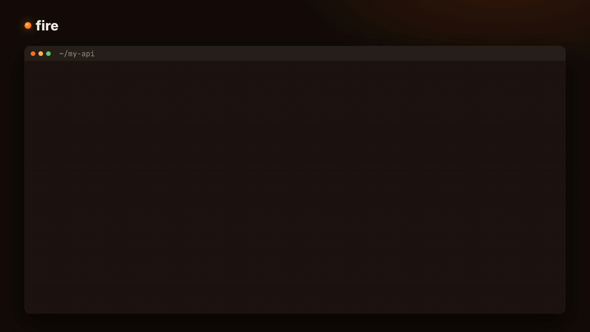

# Fire CLI 🔥

[](https://github.com/gbenm/fire/releases/latest)
[](https://crates.io/crates/fire-cli)
[](https://github.com/gbenm/fire/actions/workflows/ci.yml)
[](./LICENSE)

**A config-first task runner for your projects, and for the AI agents working in them.**



Put your project's commands in a `fire.yaml`, and get:

- **One entry point** for build, test, dev servers, containers, and scripts: `fire <command>`, with
  tab completion and descriptions generated from your config.
- **Agents that use your commands instead of guessing.** `fire cli mcp` exposes them to Claude
  Code, Cursor, or any MCP host, and keeps dangerous ones (`agents: false`) human-only.
- **Long-running processes you can share.** Every command runs on a pty you can detach with Ctrl+Z
  and reattach from any terminal; you and your agents see the same dev servers and logs.
- **Smart runners.** Fall back to a container when a tool isn't installed, ensure services are up
  before running, and compute arguments with JS/TS/Python snippets.

If you've used `make`, `just`, Task, or `npm run` as a command menu, Fire fills the same role and
adds completion, sessions, and an agent interface on top ([how they compare](./docs/comparison.md)).

```yaml
# fire.yaml
---
commands:
  test: cargo test
  dev:
    description: Start the API with hot reload
    long_running: true
    exec: cargo watch -x run
  npm:
    check: npm -v                                    # not installed locally?
    fallback_runner: docker run --rm -i -v .:/app -w /app node:lts-alpine sh
    exec: npm                                        # ...then run it in a container
  deploy:
    agents: false                                    # agents must ask you first
    exec: ./scripts/deploy prod
```

```bash
fire test               # run it
fire dev                # Ctrl+Z detaches; it keeps running
fire cli ps             # see what's running, from any project
fire cli fg <id>        # attach again from any terminal
```

## Install

**Homebrew** (macOS, Linux):
```bash
brew tap gbenm/labs
brew install fire
```

**Install script** (macOS, Linux x86_64/arm64):
```bash
curl -fsSL https://raw.githubusercontent.com/gbenm/fire/main/install.sh | sh
```

**Cargo**:
```bash
cargo install fire-cli
```

Or download a binary from the [latest release](https://github.com/gbenm/fire/releases/latest).

**Windows**: use [WSL](https://learn.microsoft.com/windows/wsl/install). Inside your WSL distro
(Ubuntu, Debian, ...) Fire is a regular Linux install: use the install script or Homebrew above, and
run it from the WSL terminal. Native Windows isn't supported, since sessions rely on Unix ptys.

## Quick start (5 minutes)
1) Run `fire cli init` in your project to create a `fire.yaml`:
```yaml
# yaml-language-server: $schema=https://raw.githubusercontent.com/gbenm/fire/main/schemas/fire.schema.json
---
commands:
  hello: echo "Hello Fire"
```

> **Tip:** already have `package.json` scripts, a `Makefile`, a `justfile` or a `compose.yml`?
> Ask your coding agent to write the initial config for you, for example:
> *"Create a fire.yaml for this project from its existing scripts. Use the schema in the
> `# yaml-language-server` comment, add a `description` to every command, and mark dev servers
> and watchers with `long_running: true`."*

2) Run it:
```bash
fire hello world
# => Hello Fire world
```

3) Enable completion (zsh + bash):
```bash
fire cli completion install
```

4) Optional: connect your AI agent (see [MCP server for agents](#mcp-server-for-agents)):
```bash
claude mcp add fire -- fire cli mcp
```

## Configuration at a glance
Fire loads, merges, and executes commands defined in YAML (`fire.yaml`, `*.fire.yaml`, or the same names with `.yml`). Commands can:
- run shell `exec` steps
- evaluate runtime snippets via `eval` (node/deno/python)
- rewrite arguments with `compute`
- use runners, fallback runners, and pre-run `before` hooks
- expose nested subcommands with greedy resolution

Reserved name: `cli` cannot be defined under `commands`.

## Completion
Install or refresh completion anytime:
```bash
fire cli completion install
```
- zsh shows values + descriptions
- bash uses `complete -C` values

Details: see [docs/completion.md](./docs/completion.md).

## Schema & editor support
Associate your YAML with https://raw.githubusercontent.com/gbenm/fire/main/schemas/fire.schema.json for validation (`fire cli init` does it):
- Add `$schema` to the first line: `# yaml-language-server: $schema=https://raw.githubusercontent.com/gbenm/fire/main/schemas/fire.schema.json`, followed by `---` to start the document (linters such as yamllint's `document-start` rule expect it)
- Or map file names in `.vscode/settings.json` (`yaml.schemas`).

## MCP server for agents
Let AI agents use the commands you already configured, and launch long-running processes as
managed sessions you can inspect, signal, and attach to:
```bash
fire cli mcp
```
Mark commands agents shouldn't touch (deploys, destructive DB tasks) with `agents: false`.
Details: see [docs/mcp.md](./docs/mcp.md).

- Claude Code: `claude mcp add --scope user fire -- fire cli mcp`
- Codex, VS Code, Cursor, Claude Desktop, Gemini CLI, Windsurf: see [setup per host](./docs/mcp.md#usage)
- MCP Registry name: `mcp-name: io.github.gbenm/fire`

## Sessions
In a terminal, every `fire` command runs on a pty under a small supervisor. It behaves exactly as if
run directly (colors, prompts, Ctrl+C, exit code), but **Ctrl+Z detaches it** while it keeps
running: `fg` brings it back, and `fire cli fg <id>` attaches to it from any other terminal. You and
your agents can list sessions from any project, read their output, type into them, signal or stop
them:
```bash
fire cli bg -m "api for auth tests" api dev   # start one detached
fire cli ps                                   # running ones; -a/--failed/--stopped/--exited for the rest
fire cli fg <id>
```
Mark servers and watchers with `long_running: true` so they detach on their own when an agent or a
script runs them without a terminal. Details: see [docs/sessions.md](./docs/sessions.md).

## Documentation map
- [Overview](./docs/overview.md)
- [Fire compared to make, just, Task, mise and npm scripts](./docs/comparison.md)
- [Commands & arguments](./docs/commands-and-args.md)
- [Runtimes & eval](./docs/runtimes-and-eval.md)
- [Shell completion](./docs/completion.md)
- [MCP server](./docs/mcp.md)
- [Sessions](./docs/sessions.md)
- [Progressive examples](./docs/examples.md)
- [Troubleshooting](./docs/troubleshooting.md)

## Contributing
Bug reports, ideas, and pull requests are welcome. See [CONTRIBUTING.md](./CONTRIBUTING.md), and
share your setups or ask questions in [Discussions](https://github.com/gbenm/fire/discussions).
If Fire saves you time, a ⭐ helps other people find it.

## If you enjoyed this and want to buy me a coffee ☕️
- Buy Me a Coffee: https://buymeacoffee.com/gbenm
- Bitcoin (BTC): `bc1q0l8na5gr6jgpnq6r7fj0nl3hqx2dm77l2vearuxx20s5ktes45vsxmksfu`
- USDC (Ethereum ERC20): `0x26D01f6fBa520D343CDAF309ba04FB9a7B26b4DE`

