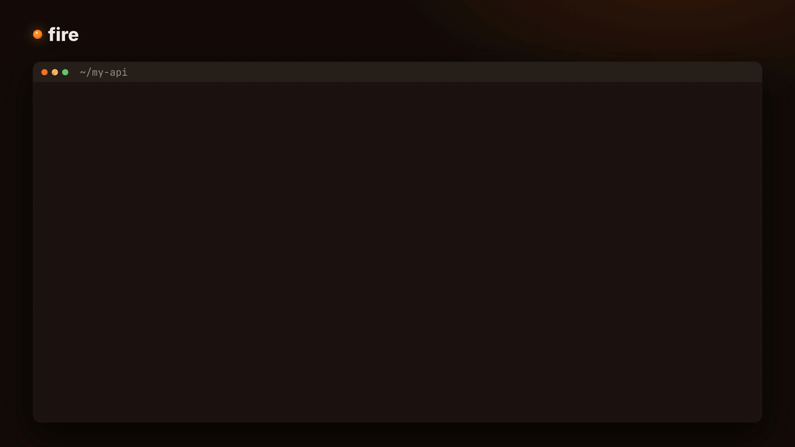

# Fire CLI 🔥

Fire is a config-first task runner for your projects, and for the AI agents working in them.



Put your project's commands in a `fire.yaml` to get one entry point for builds, tests, dev servers,
containers, and scripts. Fire generates shell completion from that config, exposes safe commands to
agents over MCP, and runs commands in sessions that you can detach and reattach from any terminal.

If you use `make`, `just`, Task, mise tasks, or npm scripts as a command menu, see the honest
[comparison](./comparison.md) to decide where Fire fits.

## Install

With Homebrew on macOS or Linux:

```bash
brew tap gbenm/labs
brew install fire
```

With the install script on macOS or Linux (x86_64 or arm64):

```bash
curl -fsSL https://raw.githubusercontent.com/gbenm/fire/main/install.sh | sh
```

Or install from crates.io with `cargo install fire-cli`. Native Windows is not supported; use
[WSL](https://learn.microsoft.com/windows/wsl/install) and install Fire inside the Linux distro.

## 30-second quickstart

Create `fire.yaml` in your project:

```yaml
# yaml-language-server: $schema=https://raw.githubusercontent.com/gbenm/fire/main/schemas/fire.schema.json
---
commands:
  hello:
    description: Greet someone
    exec: echo "Hello"
```

Then run the command and enable completion:

```bash
fire hello world       # prints: Hello world
fire cli completion install
```

Run `fire cli init` instead if you want Fire to create the initial file interactively. Continue
with the [overview](./overview.md), or jump to [commands and arguments](./commands-and-args.md).
